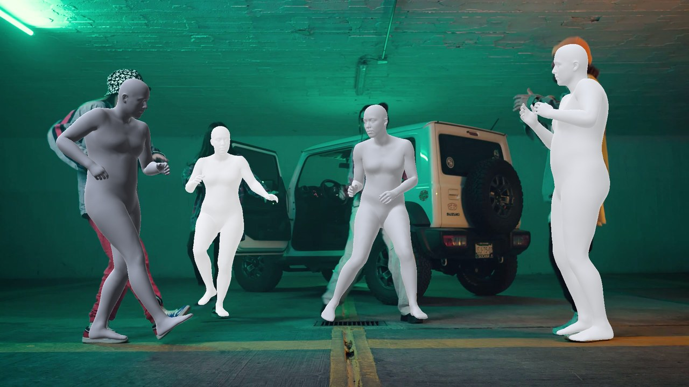
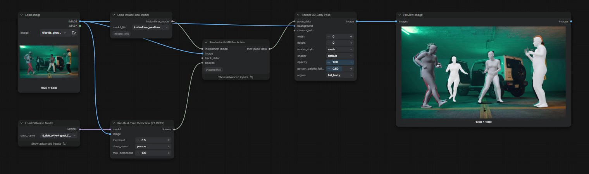

English | [中文](README.zh-CN.md)

# ComfyUI-InstantHMR

[InstantHMR](https://github.com/Naturalpad-studio/InstantHMR) recovers the 3D body of every person in an image or video: pose, body shape, 70 keypoints in 2D and 3D, and the full [MHR](https://github.com/facebookresearch/MHR) body mesh. It is a small, fast model (20-32 M parameters) that outputs the same MHR body as ComfyUI's SAM 3D Body, so its result plugs into the native SAM 3D Body nodes for smoothing, rendering and 3D export.



## Nodes

| Node | What it does |
| --- | --- |
| `Load InstantHMR Model` | loads an InstantHMR checkpoint from `models/detection` |
| `Run InstantHMR Prediction` | predicts one MHR body per person box and outputs `MHR_POSE_DATA` |

`Run InstantHMR Prediction` takes person boxes from `RT-DETR Detect` (class `person`) or tracks from `SAM3 Video Track`; with neither, the whole frame is one person. `fov` is the vertical field of view in degrees; connect `MoGe` through `MoGe Geometry To FOV` for the camera of a video, or leave it at 0 for a focal of 1.05x the image diagonal.

The output works with the native nodes:

- `Smooth SAM3D Body Pose Data` for video jitter
- `Render 3D Body Pose`: mesh, silhouette, OpenPose 2D/3D, SCAIL
- `Create 3D Animation File`: animated GLB in the `openpose` and `scail` styles. The `body_mesh` and `bones_only` styles and BVH read the MHR rig from a `sam3d_body_model` input, so connect a SAM 3D Body loader for those.



## Models

| File | Backbone | 3DPW PA-MPJPE (mm) | Licence |
| --- | --- | --- | --- |
| `instanthmr_nano.safetensors` | HGNetV2-B0 | 46.6 | CC BY-NC 4.0 |
| `instanthmr_tiny.safetensors` | HGNetV2-B1 | 44.0 | CC BY-NC 4.0 |
| `instanthmr_small.safetensors` | HGNetV2-B2 | 41.7 | CC BY-NC 4.0 |
| `instanthmr_medium.safetensors` | HGNetV2-B4 | 40.0 | CC BY-NC 4.0 |
| `instanthmr_medium_commercial.safetensors` | HGNetV2-B4 | 50.7 | Apache-2.0 |

Put them in `models/detection`. Each file holds the network and the MHR body rig it is trained on, so no other model is needed. The CC BY-NC weights are for non-commercial use; `medium_commercial` is trained on commercially usable images only.

### Converting the released ONNX files

The upstream release ships ONNX graphs on [Hugging Face](https://huggingface.co/momolesang/InstantHMR). `scripts/convert_onnx.py` turns one into a checkpoint for this pack, taking the MHR rig from ComfyUI's SAM 3D Body checkpoint ([`sam_3d_body_dinov3_bf16.safetensors`](https://huggingface.co/Comfy-Org/sam-3d-body)). It needs `onnx`, and checks the result against the ONNX graph when `onnxruntime` is installed. From the ComfyUI folder:

```
pip install onnx onnxruntime
python custom_nodes/ComfyUI-InstantHMR/scripts/convert_onnx.py instanthmr-medium.onnx \
    models/detection/sam_3d_body_dinov3_bf16.safetensors models/detection/instanthmr_medium.safetensors \
    --body mhr-body.onnx
```

## Example workflows

- `example_workflows/instanthmr_image.json`: RT-DETR boxes on a photo, rendered as meshes over the image.
- `example_workflows/instanthmr_video.json`: the SAM 3D Body video template with InstantHMR: SAM3 tracks, MoGe FoV, smoothing, a rendered video and a SCAIL GLB.

## Tips

- InstantHMR is trained on whole people. On close-ups that cut the body at the chest the pose stays good, while the mesh can sit a few percent off the person in the image; full-body shots line up closely.
- For several people in a video, use SAM3 tracks so each person keeps the same index across frames, which the smoothing node relies on.
- Smaller models (`nano`, `tiny`) are faster and less accurate; the network takes about 1 ms per person on a desktop GPU, so the detector and tracker set the speed of a workflow.

## Credits

InstantHMR by Mohamed Adjel, Kahina Chalabi and Vincent Bonnet ([paper](https://hal.science/hal-05854387)), Apache-2.0 code. The body model is Meta's [MHR](https://github.com/facebookresearch/MHR) (Apache-2.0).
