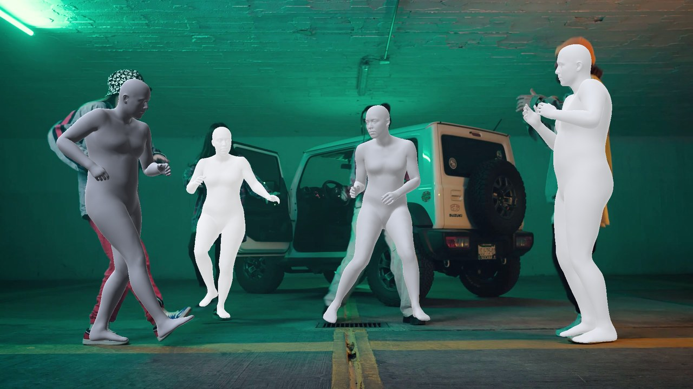
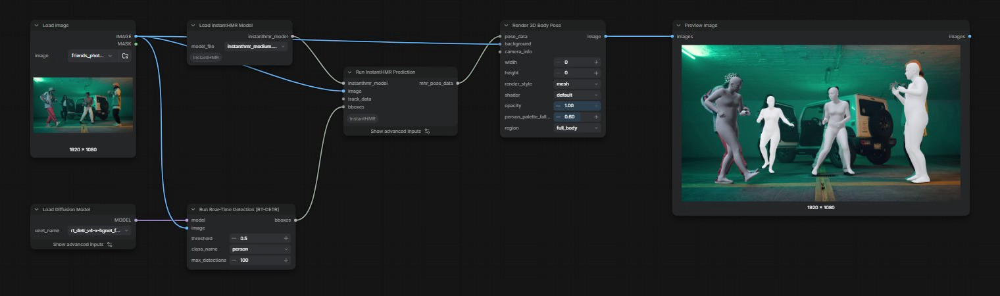
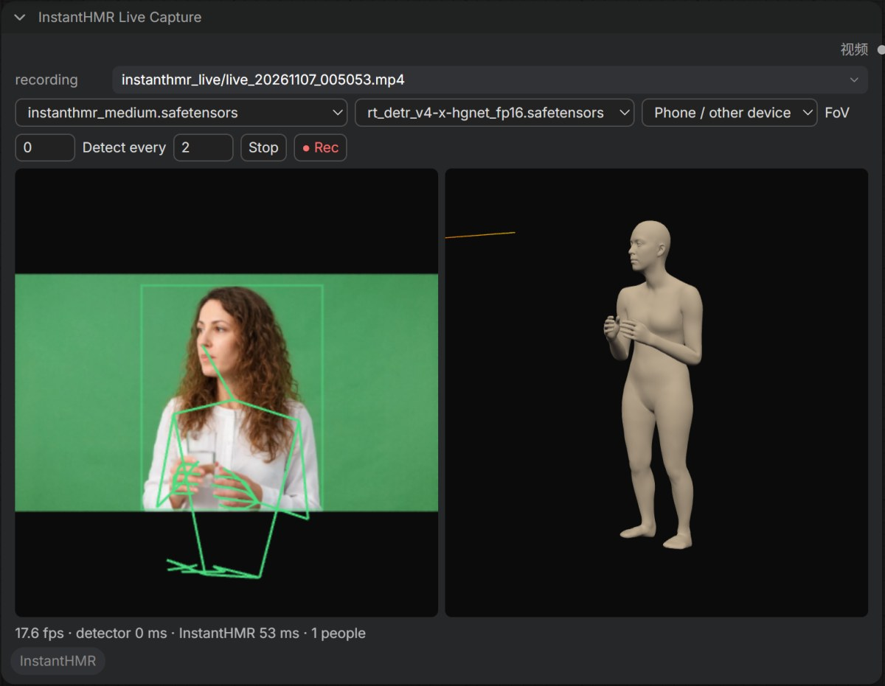

[English](README.md) | 中文

# ComfyUI-InstantHMR

[InstantHMR](https://github.com/Naturalpad-studio/InstantHMR) 从图片或视频中恢复每个人的 3D 身体：姿态、体型、70 个 2D/3D 关键点，以及完整的 [MHR](https://github.com/facebookresearch/MHR) 人体网格。模型小而快（2000 万到 3200 万参数），输出和 ComfyUI 内置 SAM 3D Body 相同的 MHR 人体，所以结果可以直接接 SAM 3D Body 的原生节点做平滑、渲染和 3D 导出。



## 节点

| 节点 | 作用 |
| --- | --- |
| `Load InstantHMR Model` | 从 `models/detection` 加载 InstantHMR 模型 |
| `Run InstantHMR Prediction` | 对每个人物框预测一个 MHR 人体，输出 `MHR_POSE_DATA` |
| `InstantHMR Live Capture` | 摄像头实时 2D/3D 预览并录制，把录好的片段作为 `VIDEO` 输出 |

`Run InstantHMR Prediction` 的人物框可以来自 `RT-DETR Detect`（类别 `person`），也可以来自 `SAM3 Video Track` 的跟踪结果；两者都不接时，整帧当作一个人。`fov` 是垂直视场角（度）：视频可以通过 `MoGe` 和 `MoGe Geometry To FOV` 估计相机视场角，填 0 时焦距取画面对角线的 1.05 倍。

输出可以接这些原生节点：

- `Smooth SAM3D Body Pose Data`：视频去抖
- `Render 3D Body Pose`：网格、剪影、OpenPose 2D/3D、SCAIL
- `Create 3D Animation File`：`openpose` 和 `scail` 风格的动画 GLB。`body_mesh`、`bones_only` 风格和 BVH 要从 `sam3d_body_model` 输入读取 MHR 骨架，用这几种时请接一个 SAM 3D Body 加载器。



## 实时采集



`InstantHMR Live Capture` 对摄像头画面实时运行 RT-DETR 和 InstantHMR：左边是叠加了 2D 骨架的画面，右边是 3D 人体（可拖动旋转）。在节点里选好 InstantHMR 模型、RT-DETR 检测器和摄像头，按 `Start`。

- **This device**：使用打开 ComfyUI 的这台设备的摄像头。
- **Phone / other device**：节点显示二维码，同一局域网的手机扫码后，手机页面推送摄像头画面并显示骨架，节点显示 3D 视图。
- `● Rec` 把收到的画面录到 `input/instanthmr_live/`。新片段会自动选中到 `recording` 列表，运行工作流时作为 `VIDEO` 输出，接 `Get Video Components` → `Run InstantHMR Prediction` 及后续流程（`example_workflows/instanthmr_live.json`）。
- `Detect every`：每 N 帧运行一次检测器，中间几帧沿用上次的人物框；检测器是最慢的一步，设 2–3 预览更流畅。`FoV` 和预测节点的 `fov` 含义相同。

浏览器只在 `localhost` 或 HTTPS 下允许打开摄像头。手机使用时，用证书启动 ComfyUI，例如自签名证书：

```
openssl req -x509 -newkey rsa:2048 -nodes -days 825 -keyout key.pem -out cert.pem -subj "/CN=ComfyUI" -addext "subjectAltName=IP:192.168.0.10"
python main.py --listen 0.0.0.0 --tls-keyfile key.pem --tls-certfile cert.pem
```

`subjectAltName` 填电脑的局域网地址，用 `https://<地址>:8188` 打开 ComfyUI，电脑和手机上各接受一次证书警告。

## 模型

| 文件 | 主干网络 | 3DPW PA-MPJPE (mm) | 许可证 |
| --- | --- | --- | --- |
| `instanthmr_nano.safetensors` | HGNetV2-B0 | 46.6 | CC BY-NC 4.0 |
| `instanthmr_tiny.safetensors` | HGNetV2-B1 | 44.0 | CC BY-NC 4.0 |
| `instanthmr_small.safetensors` | HGNetV2-B2 | 41.7 | CC BY-NC 4.0 |
| `instanthmr_medium.safetensors` | HGNetV2-B4 | 40.0 | CC BY-NC 4.0 |
| `instanthmr_medium_commercial.safetensors` | HGNetV2-B4 | 50.7 | Apache-2.0 |

放到 `models/detection`。每个文件都包含网络和它训练时用的 MHR 人体骨架，不需要其他模型。CC BY-NC 的权重仅限非商业使用；`medium_commercial` 只用可商用图片训练。

### 转换官方 ONNX 文件

上游在 [Hugging Face](https://huggingface.co/momolesang/InstantHMR) 发布的是 ONNX 计算图。`scripts/convert_onnx.py` 把它转换成本节点包用的模型文件，MHR 骨架取自 ComfyUI 的 SAM 3D Body 模型（[`sam_3d_body_dinov3_bf16.safetensors`](https://huggingface.co/Comfy-Org/sam-3d-body)）。脚本需要 `onnx`；装了 `onnxruntime` 时会把转换结果和 ONNX 计算图逐项比对。在 ComfyUI 目录下运行：

```
pip install onnx onnxruntime
python custom_nodes/ComfyUI-InstantHMR/scripts/convert_onnx.py instanthmr-medium.onnx \
    models/detection/sam_3d_body_dinov3_bf16.safetensors models/detection/instanthmr_medium.safetensors \
    --body mhr-body.onnx
```

## 示例工作流

- `example_workflows/instanthmr_image.json`：照片上用 RT-DETR 找人，把网格渲染叠在原图上。
- `example_workflows/instanthmr_video.json`：把 SAM 3D Body 视频模板换成 InstantHMR，包含 SAM3 跟踪、MoGe 视场角、平滑、渲染视频和 SCAIL GLB。
- `example_workflows/instanthmr_live.json`：同一流程，输入换成 `InstantHMR Live Capture` 录的片段。

## 使用建议

- InstantHMR 用完整人体训练。胸部以下被裁掉的近景里姿态依然准确，网格和画面中的人可能错开几个百分点；全身镜头对得很准。
- 视频里有多个人时，用 SAM3 跟踪，让每个人在各帧保持同一个序号，平滑节点依赖这一点。
- 小模型（`nano`、`tiny`）更快、精度略低；在桌面 GPU 上网络每人约 1 ms，整个工作流的速度主要取决于检测和跟踪。

## 致谢

InstantHMR 作者 Mohamed Adjel、Kahina Chalabi、Vincent Bonnet（[论文](https://hal.science/hal-05854387)），代码 Apache-2.0。人体模型是 Meta 的 [MHR](https://github.com/facebookresearch/MHR)（Apache-2.0）。
